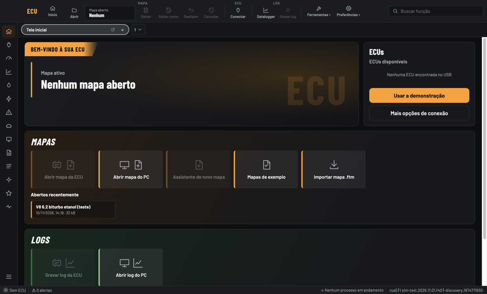
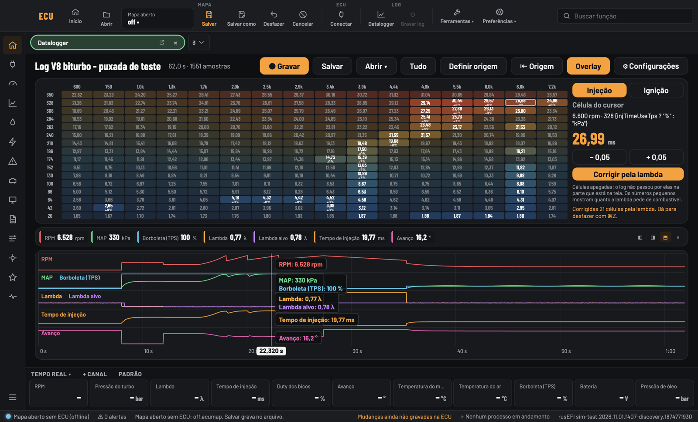
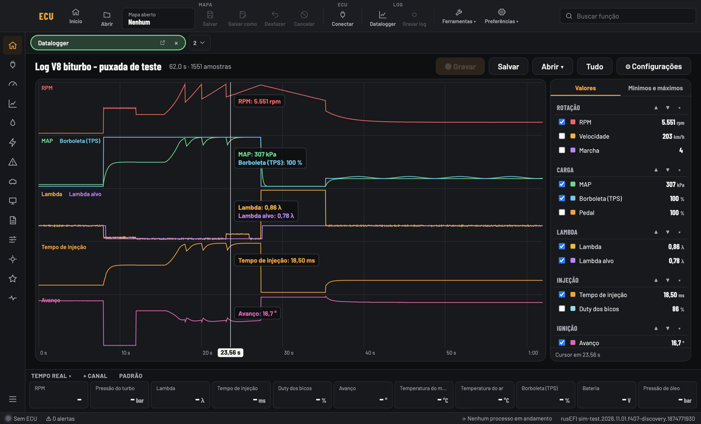
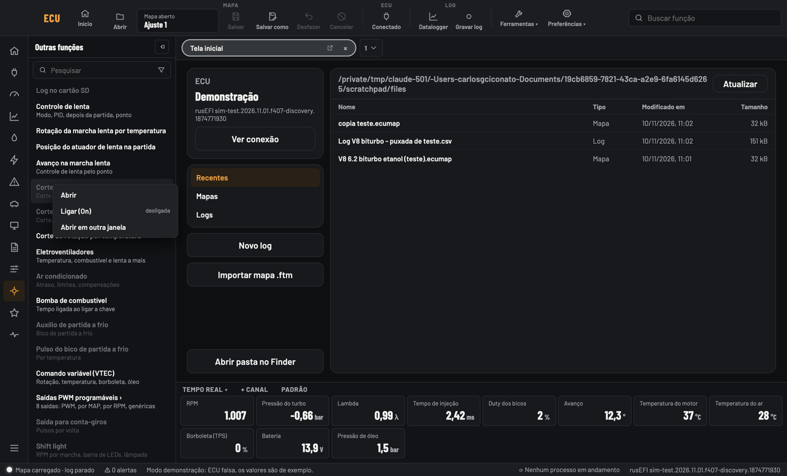
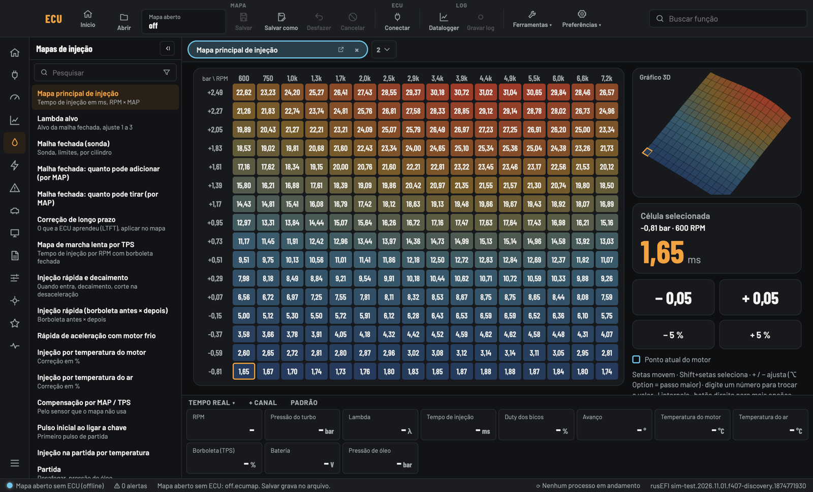
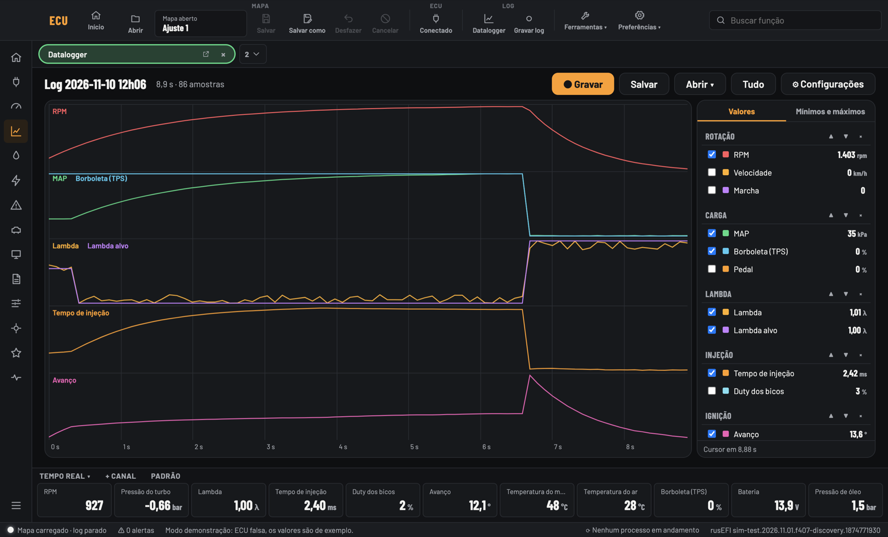
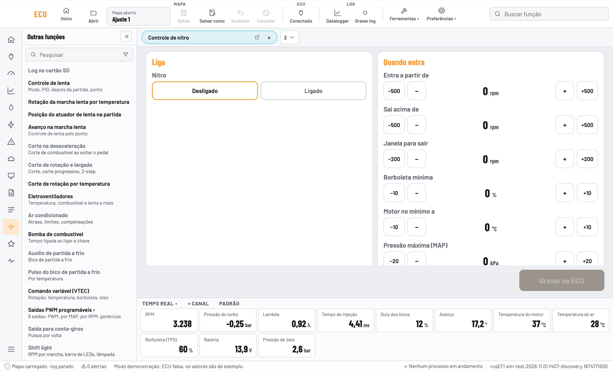

# ECU — programa de ajuste da injeção

Programa para ajustar a nossa ECU (base rusEFI) no computador, no estilo dos programas profissionais.
Funciona no **Mac** e no **Windows**, com a ECU no cabo USB, no simulador, em modo demonstração
ou **sem ECU** (abrindo o arquivo do mapa).



## Baixar

Vá em **[Releases](../../releases)** e baixe:

| Sistema | Arquivo |
|---|---|
| Mac (Intel) | `ECU-<versão>-mac-intel.dmg` |
| Windows 64 bits | `ECU-<versão>-windows-setup.exe` |

**Mac:** abra o .dmg e arraste o ECU para Aplicativos. Na primeira vez: botão direito no ECU > Abrir > Abrir.
Se o macOS bloquear, vá em Ajustes do Sistema > Privacidade e Segurança > "Abrir Mesmo Assim".

**Windows:** abra o .exe. Se aparecer "O Windows protegeu o computador", clique em
**Mais informações > Executar assim mesmo**.

O app não tem assinatura digital, por isso esses avisos.

## O que tem

- **Tela inicial** com o mapa ativo, as ECUs encontradas no USB e os mapas e logs recentes.
- **Barra superior** com Abrir, Salvar, Salvar como, Desfazer, Cancelar, Conectar, Datalogger, Ferramentas e Preferências.
- **Menu lateral** com os grupos de funções; funções ligadas em branco e desligadas em cinza (botão direito: On/Off).
- **Abas** com a lista das funções abertas separada por grupo; dá para abrir uma função em outra janela.
- **Mapas** com teclado e mouse: setas, + / −, digitar valor, somar (A), multiplicar (M), interpolar (I, H, V),
  suavizar (S), copiar e colar, botão direito; **gráfico 3D** ao lado.
- **Mapa sem ECU (offline):** abre o arquivo `.ecumap`, edita e salva no arquivo.
- **Datalogger:** gravar (no botão ou sozinho por RPM/borboleta), grupos de canais, valores no cursor,
  mínimos e máximos, origem, canais matemáticos, cor/escala/suavização por canal e **Overlay**
  (o mapa dentro do log, com correção pela lambda).
- **Painel em tempo real** escolhido por função, **LED de situação** e tarefas em segundo plano.
- **Temas** escuro, claro 1, claro 2 e cor de destaque.

| | |
|---|---|
|  |  |
|  |  |
|  |  |

## Arquivos

Os mapas (`.ecumap`) e logs (`.csv`) ficam em `Documentos/ECU Arquivos/Mapas` e `.../Logs`.
Um mapa só abre num firmware com a mesma assinatura do `.ini` do app.

## Para desenvolver

Precisa do Node 22.

```bash
npm install
npm run app        # abre a janela direto do código
npm run dist:mac   # gera o .dmg em release/
npm run dist:win   # gera o instalador de Windows em release/
```

- `src/ui` — telas (React). `src/ui/Desktop.tsx` é o layout de computador.
- `src/bridge` — a ponte que fala com a ECU (rede, USB serial, demonstração, mapa offline).
- `src/core` — protocolo, .ini, codec e arquivos .ftm.
- `electron/main.mjs` — a janela do app.
- `ini/simulador.ini` — definição do firmware atual.
- `scripts/` — gera o mapa e o log de exemplo do V8 biturbo.

Mais detalhes em [LEIAME.md](LEIAME.md).
